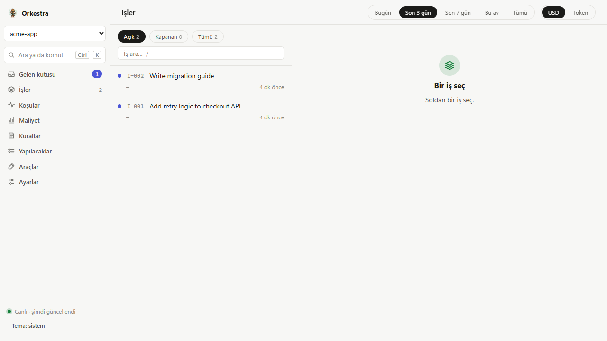

# agenchestra

[Türkçe README](README.tr.md)

**A Claude Code plugin that plans work, hands it to the cheapest capable model, and makes a separate agent verify every result.**

[](https://github.com/mertdurukan/agenchestra/actions/workflows/orkestra-test.yml)
[](LICENSE)
[](https://www.python.org/)



## Why

- **Cost ladder.** Every task starts on the cheapest allowed rung: script, Haiku 5.5, Sonnet 5.5, Opus 5.5 medium, Opus 5.5 xhigh. A task rejected twice on a rung moves up one.
- **Separate verifier.** A dedicated `denetci` agent checks each worker's output against the task's acceptance criteria. Nobody approves their own work; this is enforced by agent tool restrictions, hook-injected identity and a CLI check.
- **Parallel waves.** Task cards run as a dependency graph. Tasks whose write areas do not overlap run at the same time, and a hook rejects writes outside a task's area.
- **Live panel.** A local HTML panel (`http://127.0.0.1:8765/`, this machine only) shows jobs, cost per agent, process and model, and items waiting for your approval. A token ledger records usage per agent, process and model.

## Install

Requires Claude Code, Python 3 and `git`.

1. Clone the repository: `git clone https://github.com/mertdurukan/agenchestra.git`
2. Create the release clone the marketplace reads from: `python agenchestra/araclar/yayin_kur.py` (add `--kuru` to preview)
3. Install the plugins for all your projects: `python agenchestra/araclar/projeye_kur.py --kullanici` (add `--kuru` to preview)

Then open a new Claude Code session in any project. Remove with `python agenchestra/araclar/projeye_kur.py --kullanici --kaldir`.

The test gate runs under the interpreter in the `ORKESTRA_PYTHON` environment variable. If it is unset, it uses `py -3.13` when available, otherwise the running Python. Install `pytest` in that interpreter (`python -m pip install pytest`) before running the tests.

## Usage

```
/orkestra:is <request>    plan, split into task cards, run workers, verify, deliver
/orkestra-web             open the live panel (shell: orkestra panel)
/orkestra:update          update the plugin from GitHub, no LLM call
/orkestra:auto <request>  run without waiting for approval until the work summary
```

By default a job pauses after it writes a current-state note, a plan and a to-do list, and starts only after you approve. Run `orkestra --help` for the full CLI.

## Architecture

```
plugins/orkestra/      core plugin
  agents/              triage, workers (T1..T4), verifier, researcher, memory keeper, skill hunter
  skills/              /orkestra:<name> skills
  workflows/           task-card DAG runner (worker -> separate verifier -> escalate)
  hooks/ scripts/      hook entry point, CLI, panel server, cost and ledger code
  tests/               unit tests
plugins/orkestra-ui/   in-app pane and above-prompt band
araclar/               install helpers (projeye_kur.py, yayin_kur.py)
```

Runtime state lives in `.claude/orkestra/` inside each project and is kept out of git. Most documentation is currently in Turkish; see [README.tr.md](README.tr.md) for the detailed reference.

## Contributing

See [CONTRIBUTING.md](CONTRIBUTING.md). The full test suite runs through `plugins/orkestra/scripts/test_paralel.py`.

## License

[MIT](LICENSE)
